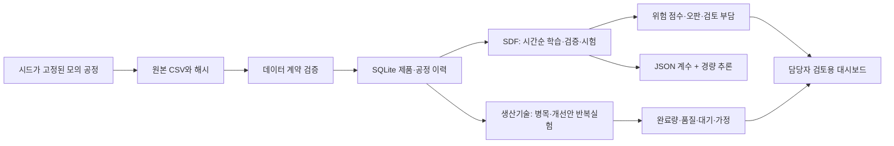

# EV Factory Lab

**제조 기업 신입 지원을 준비하는 SDF 데이터 분석 × 전동화 생산기술 1인 프로젝트**

가상의 전동화 부품 조립 라인에서 **불량 위험 분석 → 병목 확인 → 개선안 실험 → 근거 기록**을 연결합니다. 공통 데이터 위에 두 개의 포트폴리오 모듈을 구현했습니다. 실제 제조 기업 공정/데이터를 재현하거나 채용 요구사항 전체를 충족했다는 의미는 아닙니다.

## 가장 빠르게 보기

1. `open-dashboard.cmd`를 더블클릭하거나 `output/index.html`을 브라우저로 엽니다. **완성된 분석 화면은 설치·API 키·인터넷 없이 열립니다.**
2. `02 SDF 데이터 분석`에서 시간순 시험 성능과 추가 점검 부담을 확인합니다.
3. `03 전동화 생산기술`에서 검사 셀 증설과 공정 편차 축소의 영향을 비교합니다.
4. `output/RESULTS.md`와 `output/verification.json`으로 실행 수치와 실제 검증 결과를 확인합니다.

## 두 직무의 독립적인 설명 포인트

| 모듈 | 해결할 질문 | 구현한 산출물 |
|---|---|---|
| SDF 데이터 분석 | 어떤 데이터를 믿고, 어느 부품을 추가 점검해야 하는가? | 데이터 계약, CSV→SQLite, SQL, 시간순 분할, 불량 위험 점수, 평가·이력 조회, 경량 추론 |
| 전동화 생산기술 | 어디에 대기가 쌓이고, 어떤 개선이 생산성과 품질을 바꾸는가? | 공정 흐름, CT/택트/대기 분석, 병렬 EOL 셀, 공정 편차 개입, 30쌍 반복 실험, 관리계획 |

각각 [SDF 포트폴리오](docs/01-SDF-portfolio.md), [전동화 포트폴리오](docs/02-electrification-portfolio.md)로 설명할 수 있습니다.

## 전체 재현

검증 환경: Windows, Python 3.14.6, NumPy 2.5.1, pandas 3.0.5, scikit-learn 1.9.0. 아래 명령은 이 폴더에서 실행합니다. 다른 Python/OS 조합은 별도 검증이 필요합니다.

```powershell
py -3 -m venv .venv
.\.venv\Scripts\python.exe -m pip install -r requirements.txt
.\.venv\Scripts\python.exe build.py
.\.venv\Scripts\python.exe verify.py
```

의존성이 설치된 현재 Python을 쓰면 `py -3 build.py`, `py -3 verify.py`만 실행해도 됩니다. `rebuild.ps1`은 두 단계를 순서대로 실행합니다. 재생성은 **이 프로젝트의 data/raw 및 output 분석 파일**을 갱신합니다. 사용자 원본 데이터를 해당 생성 경로에 덮어 넣지 마세요.

현재 빌드의 시험 지표와 모의 개선 수치는 [실행 결과](output/RESULTS.md)를 기준으로 합니다. 소스를 수정했으면 다시 빌드한 뒤 검증하여 SHA-256 목록을 갱신합니다. 시간·로컬 성능 측정은 실행 때마다 달라지며 원본 모의 데이터는 같은 시드로 재현됩니다.

브라우저 조작 검증은 선택 사항입니다. Node.js와 Microsoft Edge가 있으면 `npm install`, `npm run test:browser`로 실행합니다. 현재 UI 검증 결과는 `output/browser-verification.json`, 화면 캡처는 `output/dashboard-*.png`입니다.

## 경량 추론 / Jetson 준비

```powershell
py -3 -m factorylab.edge --model output/model.json --input examples/unit.json
```

`factorylab/edge.py`는 표준 라이브러리만 사용합니다. 학습은 PC에서 하고, JSON 계수와 경량 코드를 Jetson으로 옮겨 추론하는 구조입니다. **현재 측정은 Windows CPU에서만 수행했습니다. Jetson 설치·지연시간·실시간 센서 연결은 수행하지 않았습니다.** 결측, 미지 사양, 학습 범위 밖 입력에서는 점수를 반환하지 않습니다. 실제 장비 명령은 생성하지 않습니다.

## 구조

```text
factorylab/                 시뮬레이터·검증·모델·공정 실험·경량 추론 원본
build.py                    전체 파이프라인
verify.py / tests/          실제 실행되는 검증
web/index.html              대시보드 원본
data/raw/                   재생성 가능한 원본 CSV + 시드/가정
output/                     SQLite·모델·평가·실험·대시보드·검증 결과
docs/                       두 직무의 포트폴리오, 설계, SQL, 관리계획, 학습계획
examples/unit.json          단건 추론 예제
requirements.txt            검증한 분석 라이브러리 버전
```



## 해석 범위

- 데이터는 모두 생성한 모의 데이터입니다. 생성식과 가정은 공개되어 있으며 실제 제조 성능의 증거가 아닙니다.
- 결함을 자주 발생시킨 스트레스 시나리오이므로 시험 불합격률 약 29%는 실제 공장 불량률을 나타내지 않습니다.
- 분류 결과는 검사 우선순위 연구용 점수입니다. 최종검사 대체, 불량 확정, 자동 설비 제어를 구현하지 않았습니다.
- 개선율은 시뮬레이터가 가정한 인과 구조 안에서만 성립합니다. 설비 가격, 인원, 고장, 유한 버퍼, 물류·교대 조건을 반영하지 않았습니다.
- 규칙 기반 분석 워크플로는 실행되지만 LLM이나 자율 Agentic AI는 연결하지 않았습니다.
- AI가 생성·검증을 도운 초안입니다. 본인이 실행·수정·설명한 범위를 작업일지에 남기고, 이해하지 않은 코드를 독자 개발 경험처럼 소개하지 마세요.

## English

EV Factory Lab is a reproducible solo portfolio with two modules: SDF data analytics and electrification production engineering. It uses entirely synthetic component-assembly data. Open `output/index.html` for the dashboard, run `build.py` to regenerate the pipeline, and `verify.py` for tests. Results demonstrate this simulated system only; no company factory data, production deployment, or Jetson hardware validation is claimed.
